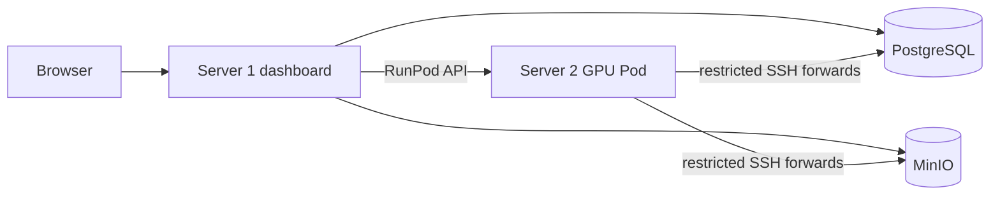

# Production file and persistence map

This map applies only to **Server 1 VPS + Server 2 RunPod**.

## Server 1 · website VPS

| File | Purpose |
|---|---|
| `control-plane/docker-compose.yml` | PostgreSQL, MinIO, migrations, dashboard, MP4 exporter, RunPod controller |
| `control-plane/.env` | VPS passwords, ports, RunPod Pod ID/API key/image digest; never committed |
| `control-plane/deploy/up.sh` | Builds and starts Server 1; enables controller when RunPod values exist |
| `control-plane/deploy/status.sh` | Shows Server 1 health and service state |
| `control-plane/Dockerfile.services` | Chromium/FFmpeg export and controller runtime |
| `scripts/artifact-export-worker.ts` | Produces downloadable digital-twin MP4s in the background |
| `scripts/runpod-controller.ts` | Starts, updates, dispatches to, and stops the configured Pod |

Persistent Docker volumes:

| Volume | Data | Back up? |
|---|---|---:|
| `postgres-data` | Jobs, stages, reviews, costs, worker state, policy records | Yes |
| `minio-data` | Uploads, poses, robot motion, videos, checkpoints, policies | Yes |
| `model-cache` | Compiled Unitree G1 browser meshes | Rebuildable |

## Server 2 · RunPod RTX 4090

| File | Purpose |
|---|---|
| `deploy/Dockerfile.gpu-worker` | Builds the x86-64 CUDA GPU image |
| `deploy/start-runpod-gpu-plane.sh` | Opens the restricted tunnel, bootstraps models, starts the worker |
| `deploy/bootstrap-models.sh` | Calls the idempotent direct installer |
| `deploy/install-direct-models.sh` | Installs and verifies PromptHMR, GMR, SMPL assets, and training runtime |
| `deploy/start-gpu-worker.sh` | Validates required engines before publishing ready capabilities |
| `deploy/verify-training-runtime.sh` | Enforces the pinned training source/patch/torch contract |
| `gpu-plane/runpod-template.example.json` | GPU, volume, command, environment, and secret references |

Persistent `/workspace` directories:

| Path | Data |
|---|---|
| `/workspace/models` | PromptHMR checkpoints and shared body models |
| `/workspace/robomotion` | Installer state, logs, and persistent support files |
| `/workspace/conda-envs` | PromptHMR, GMR, and training environments |
| `/workspace/conda-pkgs` | Downloaded Conda packages |

Stopping the Pod preserves these. Terminating the Pod can lose its attached
volume. Prefer a network volume where the chosen RunPod region supports it.

## Secrets

| Location | Contains |
|---|---|
| VPS `control-plane/.env` | Database/object-storage secrets and RunPod controller credentials |
| VPS tunnel user `authorized_keys` | Only the restricted public tunnel key |
| RunPod Secrets | Tunnel private key, pinned host key, worker storage/database values, SMPL, HF, W&B |
| VPS `~/.ssh/robomotion_github` | Read-only GitHub repository deploy key |

No secret belongs in Git or in the GPU image.

## Runtime direction



## Legacy files not used in production

```text
docker-compose.server.yml
.env.server
deploy/prepare-server.sh
deploy/deploy-server.sh
gpu-plane/docker-compose.yml
gpu-plane/.env
gpu-plane/deploy/up.sh
```

Video2Robot is not a runtime dependency. RoboMotion directly imports its
pinned PromptHMR and GMR installations through RoboMotion-owned adapters.
