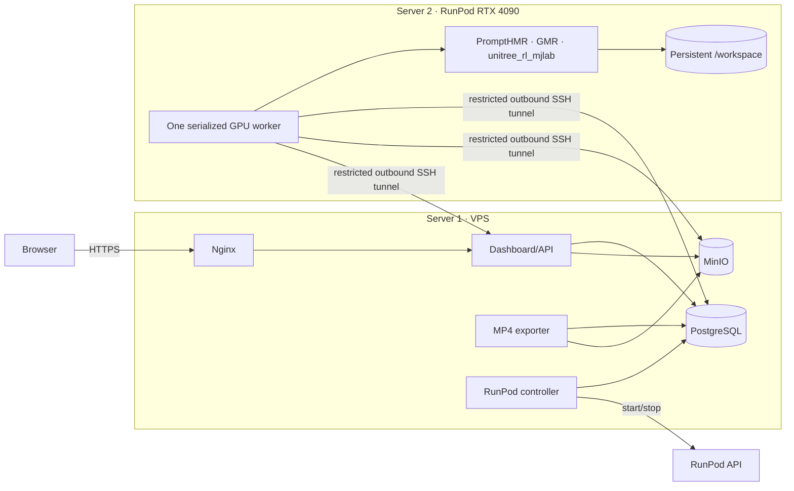

# RoboMotion production deployment

This is the **only production layout** described by this guide:

| Name | Machine | Purpose |
|---|---|---|
| Server 1 | Always-on VPS | Website, API, PostgreSQL, MinIO, MP4 exports, RunPod controller |
| Server 2 | RunPod RTX 4090 Pod | PromptHMR, GMR, digital-twin scene generation, training |

Do not run `gpu-plane/docker-compose.yml` on RunPod. It is retained only for a
fixed, self-managed GPU server.

Do not use `docker-compose.server.yml`, `.env.server`,
`deploy/prepare-server.sh`, or `deploy/deploy-server.sh`. They are the legacy
single-machine deployment.

## 1. Is the hardware suitable?

### Server 1: VPS 1000 G12

```text
4 x86 vCPU
8 GB DDR5 ECC RAM
256 GB NVMe
```

**Yes, for the MVP and a small number of users.** It does not run AI models.
It runs the dashboard, database, object storage, one Chromium MP4 exporter,
and the RunPod lifecycle controller.

Limits to watch:

- keep MP4 export concurrency at one;
- monitor RAM while Chromium exports a video;
- monitor `/var/lib/docker` because uploads, videos, checkpoints, and policies
  can fill 256 GB;
- use external S3-compatible storage before artifact volume becomes large;
- add automated PostgreSQL and object-storage backups;
- the plan's unspecified “traffic included” amount still needs checking with
  the VPS provider.

### Server 2: RunPod RTX 4090

**Yes.** One RTX 4090 is a good MVP GPU for pose extraction, retargeting,
digital-twin work, and initial policy training. RoboMotion advertises all GPU
capabilities from one worker and executes them sequentially so model stages do
not fight over one GPU.

Use a CUDA 13-compatible RunPod host because the pinned training runtime uses
PyTorch CUDA 13. PromptHMR keeps its own verified CUDA 12.1 environment.
Reduce training environment count or batch size if a recipe exceeds GPU
memory. A 48/80 GB GPU is an upgrade path, not a current requirement.

## 2. Architecture



Only these VPS ports are public:

```text
22    SSH and restricted RunPod forwarding
80    HTTP redirect / certificate setup
443   Dashboard HTTPS
```

PostgreSQL `5432`, MinIO `9000`, and Next.js `3000` stay on
`127.0.0.1`. RunPod reaches them through its outbound SSH tunnel.

## 3. Values to choose once

Replace these placeholders everywhere:

```text
DOMAIN=dashboard.example.com
VPS_HOST=dashboard.example.com
VPS_ADMIN=ubuntu
GITHUB_OWNER=SHABRAWii
GITHUB_REPOSITORY=G1-Products
GHCR_IMAGE=ghcr.io/SHABRAWii/robomotion-gpu
INSTALL_DIR=/opt/robomotion
```

Create the DNS `A` record for `DOMAIN` before requesting HTTPS.

## 4. Server 1 deployment

All commands in this section run on the **VPS**, except where marked
“workstation”. Debian 13 or Ubuntu 22.04/24.04 x86-64 is supported.

### 4.1 Base packages and firewall

```bash
sudo apt-get update
sudo apt-get install -y ca-certificates curl git nginx apache2-utils \
  certbot python3-certbot-nginx rsync ufw

sudo ufw allow OpenSSH
sudo ufw allow 'Nginx Full'
sudo ufw --force enable
sudo ufw status
```

Optional 4 GB emergency swap:

```bash
sudo fallocate -l 4G /swapfile
sudo chmod 600 /swapfile
sudo mkswap /swapfile
sudo swapon /swapfile
grep -q '^/swapfile ' /etc/fstab || \
  echo '/swapfile none swap sw 0 0' | sudo tee -a /etc/fstab
```

### 4.2 Install Docker Engine and Compose v2

This block detects Debian versus Ubuntu and selects the matching official
Docker repository. It works when logged in as `root` or as a sudo-capable user.

```bash
. /etc/os-release

case "$ID" in
  debian|ubuntu) DOCKER_DISTRO="$ID" ;;
  *) echo "Unsupported distribution: $ID" >&2; exit 1 ;;
esac

DOCKER_SUITE="${VERSION_CODENAME:-${UBUNTU_CODENAME:-}}"
test -n "$DOCKER_SUITE" || {
  echo 'Could not determine the distribution codename.' >&2
  exit 1
}

if [ "$(id -u)" -eq 0 ]; then
  SUDO=''
else
  SUDO='sudo'
fi

$SUDO rm -f /etc/apt/sources.list.d/docker.list \
  /etc/apt/sources.list.d/docker.sources \
  /etc/apt/keyrings/docker.asc

$SUDO apt-get update
$SUDO apt-get install -y ca-certificates curl
$SUDO install -m 0755 -d /etc/apt/keyrings
$SUDO curl -fsSL "https://download.docker.com/linux/$DOCKER_DISTRO/gpg" \
  -o /etc/apt/keyrings/docker.asc
$SUDO chmod a+r /etc/apt/keyrings/docker.asc

cat <<EOF | $SUDO tee /etc/apt/sources.list.d/docker.sources >/dev/null
Types: deb
URIs: https://download.docker.com/linux/$DOCKER_DISTRO
Suites: $DOCKER_SUITE
Components: stable
Architectures: $(dpkg --print-architecture)
Signed-By: /etc/apt/keyrings/docker.asc
EOF

$SUDO apt-get update
$SUDO apt-get install -y \
  docker-ce \
  docker-ce-cli \
  containerd.io \
  docker-buildx-plugin \
  docker-compose-plugin

$SUDO systemctl enable --now docker

docker run --rm hello-world
docker compose version
```

If you are not logged in as `root`, optionally allow your deployment user to
run Docker without `sudo`, then log out and back in once:

```bash
sudo usermod -aG docker "$USER"
```

### 4.3 Give the VPS read-only access to the private GitHub repository

Generate a dedicated key on the VPS:

```bash
install -d -m 700 "$HOME/.ssh"
ssh-keygen -t ed25519 \
  -C "robomotion-server1-deploy" \
  -f "$HOME/.ssh/robomotion_github" \
  -N ''
cat "$HOME/.ssh/robomotion_github.pub"
```

In GitHub:

```text
Repository → Settings → Deploy keys → Add deploy key
Title: robomotion-server1
Key: paste the printed public key
Allow write access: OFF
```

Test and clone:

```bash
ssh -T -i "$HOME/.ssh/robomotion_github" \
  -o IdentitiesOnly=yes git@github.com

sudo install -d -o "$USER" -g "$USER" /opt/robomotion
GIT_SSH_COMMAND="ssh -i $HOME/.ssh/robomotion_github -o IdentitiesOnly=yes" \
  git clone git@github.com:SHABRAWii/G1-Products.git /opt/robomotion

cd /opt/robomotion
git config core.sshCommand \
  "ssh -i $HOME/.ssh/robomotion_github -o IdentitiesOnly=yes"
git rev-parse HEAD
```

The RunPod Pod does **not** need this GitHub key. It runs a built container
image from GHCR.

### 4.4 Copy the verified browser G1 meshes

Run on the **development workstation** from the repository root:

```bash
ssh VPS_ADMIN@VPS_HOST \
  'mkdir -p /opt/robomotion/.robomotion/cache/unitree-g1-web'

rsync -av --delete .robomotion/cache/unitree-g1-web/ \
  VPS_ADMIN@VPS_HOST:/opt/robomotion/.robomotion/cache/unitree-g1-web/
```

Verify on the VPS. The result must be at least 30:

```bash
find /opt/robomotion/.robomotion/cache/unitree-g1-web \
  -maxdepth 1 -name '*.compiled.stl' | wc -l
```

### 4.5 Create the VPS environment

```bash
cd /opt/robomotion
cp control-plane/.env.example control-plane/.env
chmod 600 control-plane/.env
openssl rand -hex 32
openssl rand -hex 32
nano control-plane/.env
```

Use the generated values here:

```dotenv
POSTGRES_PASSWORD=FIRST_GENERATED_SECRET
OBJECT_STORAGE_BUCKET=robomotion
OBJECT_STORAGE_ACCESS_KEY=robomotion-control
OBJECT_STORAGE_SECRET_KEY=SECOND_GENERATED_SECRET

APP_PORT=3000
APP_BIND_ADDRESS=127.0.0.1
CONTROL_PRIVATE_BIND_ADDRESS=127.0.0.1
POSTGRES_PORT=5432
OBJECT_STORAGE_PORT=9000

ROBOMOTION_WEB_MODEL_SOURCE=../.robomotion/cache/unitree-g1-web
ROBOMOTION_DIGITAL_TWIN_FPS=60
ROBOMOTION_DIGITAL_TWIN_CRF=15

RUNPOD_API_KEY=
RUNPOD_POD_ID=
RUNPOD_GPU_IMAGE=
RUNPOD_IDLE_AFTER_SECONDS=900
RUNPOD_CONTROLLER_POLL_MS=5000
```

Never commit `control-plane/.env`.

### 4.6 Start the control plane

```bash
cd /opt/robomotion
bash control-plane/deploy/up.sh
bash control-plane/deploy/status.sh
curl http://127.0.0.1:3000/api/health
```

Expected health result:

```json
{"status":"ok","database":{"configured":true,"reachable":true}}
```

### 4.7 Put the website behind temporary authentication and HTTPS

The MVP does not yet have application login. Protect the complete site with
Nginx basic authentication until application authentication is implemented.

```bash
sudo htpasswd -c /etc/nginx/robomotion.htpasswd YOUR_ADMIN_USERNAME
```

Create `/etc/nginx/sites-available/robomotion`:

```nginx
server {
    listen 80;
    server_name dashboard.example.com;

    client_max_body_size 10G;
    auth_basic "RoboMotion";
    auth_basic_user_file /etc/nginx/robomotion.htpasswd;

    location / {
        proxy_pass http://127.0.0.1:3000;
        proxy_http_version 1.1;
        proxy_set_header Host $host;
        proxy_set_header X-Real-IP $remote_addr;
        proxy_set_header X-Forwarded-For $proxy_add_x_forwarded_for;
        proxy_set_header X-Forwarded-Proto $scheme;
        proxy_request_buffering off;
        proxy_read_timeout 3600;
        proxy_send_timeout 3600;
    }
}
```

Enable it and request TLS:

```bash
sudo ln -sfn /etc/nginx/sites-available/robomotion \
  /etc/nginx/sites-enabled/robomotion
sudo rm -f /etc/nginx/sites-enabled/default
sudo nginx -t
sudo systemctl reload nginx
sudo certbot --nginx -d dashboard.example.com
curl -I https://dashboard.example.com
```

## 5. Create the restricted RunPod-to-VPS tunnel

### 5.1 Create an unprivileged forwarding user on Server 1

Run on the VPS:

```bash
sudo adduser --disabled-password --gecos '' robomotion-tunnel
sudo install -d -m 700 -o robomotion-tunnel -g robomotion-tunnel \
  /home/robomotion-tunnel/.ssh
```

### 5.2 Generate the tunnel key on the workstation

Run on the trusted development workstation:

```bash
ssh-keygen -t ed25519 \
  -C "robomotion-runpod-tunnel" \
  -f "$HOME/.ssh/robomotion_runpod_tunnel" \
  -N ''
cat "$HOME/.ssh/robomotion_runpod_tunnel.pub"
```

Copy the printed public key. On the VPS, add it with forwarding restricted to
the three loopback services:

```bash
PUBLIC_KEY='PASTE_THE_COMPLETE_SSH_ED25519_PUBLIC_KEY'
printf '%s %s\n' \
  'restrict,port-forwarding,permitopen="127.0.0.1:5432",permitopen="127.0.0.1:9000",permitopen="127.0.0.1:3000"' \
  "$PUBLIC_KEY" | \
  sudo tee /home/robomotion-tunnel/.ssh/authorized_keys >/dev/null
sudo chown robomotion-tunnel:robomotion-tunnel \
  /home/robomotion-tunnel/.ssh/authorized_keys
sudo chmod 600 /home/robomotion-tunnel/.ssh/authorized_keys
```

Back on the workstation, collect the two values that become RunPod secrets:

```bash
cat "$HOME/.ssh/robomotion_runpod_tunnel"
ssh-keyscan -t ed25519 VPS_HOST > /tmp/robomotion-vps-host-key
ssh-keygen -lf /tmp/robomotion-vps-host-key
```

On the VPS, print its real fingerprint:

```bash
sudo ssh-keygen -lf /etc/ssh/ssh_host_ed25519_key.pub
sudo sshd -T | grep -i '^allowtcpforwarding'
```

The two SHA-256 fingerprints must match, and forwarding must be `yes` or
`local`. After verification, use the complete contents of
`/tmp/robomotion-vps-host-key` as the known-hosts secret. The private key and
known-hosts value must never enter Git.

## 6. Build and publish the GPU image

Run from the repository on the development workstation or a trusted CI runner.
Create a GitHub classic personal access token with `write:packages` and
`read:packages`, then:

```bash
export GHCR_USER=YOUR_GITHUB_USERNAME
export GHCR_IMAGE=ghcr.io/GITHUB_OWNER/robomotion-gpu
export VERSION="$(git rev-parse --short=12 HEAD)"

read -rsp 'GitHub package token: ' GHCR_TOKEN; echo
printf '%s' "$GHCR_TOKEN" | \
  docker login ghcr.io -u "$GHCR_USER" --password-stdin
unset GHCR_TOKEN

docker buildx create --name robomotion-builder --use 2>/dev/null || \
  docker buildx use robomotion-builder
docker buildx build \
  --platform linux/amd64 \
  -f deploy/Dockerfile.gpu-worker \
  -t "$GHCR_IMAGE:$VERSION" \
  --push .

docker buildx imagetools inspect "$GHCR_IMAGE:$VERSION"
```

Copy the published immutable value in this form:

```text
ghcr.io/GITHUB_OWNER/robomotion-gpu@sha256:...
```

If the GHCR package is private, configure its registry credentials in RunPod.
The Pod needs `read:packages` only.

## 7. Configure RunPod

### 7.1 Add RunPod secrets

In RunPod, open **Settings → Secrets** and add:

| RunPod secret name | Value |
|---|---|
| `robomotion_control_ssh_key` | Private key from `~/.ssh/robomotion_runpod_tunnel` |
| `robomotion_control_ssh_known_hosts` | Exact `ssh-keyscan -H VPS_HOST` output |
| `robomotion_db_password` | VPS `POSTGRES_PASSWORD` |
| `robomotion_object_storage_secret` | VPS `OBJECT_STORAGE_SECRET_KEY` |
| `robomotion_smplx_username` | Licensed SMPL-X account username |
| `robomotion_smplx_password` | Licensed SMPL-X account password |
| `robomotion_smpl_username` | Licensed SMPL account username |
| `robomotion_smpl_password` | Licensed SMPL account password |
| `robomotion_hf_token` | Hugging Face token |
| `robomotion_wandb_api_key` | Weights & Biases API key |

The first model install downloads the PromptHMR bundle from its published
sources. The Hugging Face token improves Hugging Face authentication/rate
limits; it does not replace the SMPL licenses or every Google Drive download.

### 7.2 Create the RunPod template

Use [`gpu-plane/runpod-template.example.json`](../gpu-plane/runpod-template.example.json)
as the source of truth. Replace:

```text
imageName     → immutable GHCR image digest
SSH host      → VPS_HOST
SSH user      → robomotion-tunnel
```

Required template properties:

```text
GPU: NVIDIA GeForce RTX 4090 x 1
Container disk: 100 GB
Persistent volume: 300 GB mounted at /workspace
Start command: bash deploy/start-runpod-gpu-plane.sh
Worker stages: pose_extraction,robot_retargeting,visualization,training
```

Choose a CUDA 13-compatible host. A network volume is preferable when the
selected region/GPU supports it. Otherwise keep the same Pod and stop it; do
not terminate it or delete its volume.

The entry point automatically:

1. opens the restricted SSH tunnel to Server 1;
2. reuses `/workspace/models`, `/workspace/conda-envs`, and package caches;
3. installs only missing or invalid model/runtime components;
4. validates PromptHMR, GMR, and training;
5. starts one serialized worker with all GPU capabilities.

The first start can take a long time. Later starts verify and reuse the cache.

### 7.3 Create the Pod and record its ID

Deploy one Pod from the template, confirm `/workspace` is mounted, then stop
the Pod without terminating it. Copy its Pod ID.

Create a RunPod API key for the lifecycle controller. Store both only on the
VPS:

```bash
cd /opt/robomotion
nano control-plane/.env
```

Set:

```dotenv
RUNPOD_API_KEY=YOUR_RUNPOD_API_KEY
RUNPOD_POD_ID=YOUR_RUNPOD_POD_ID
RUNPOD_GPU_IMAGE=ghcr.io/GITHUB_OWNER/robomotion-gpu@sha256:YOUR_DIGEST
RUNPOD_IDLE_AFTER_SECONDS=900
RUNPOD_CONTROLLER_POLL_MS=5000
```

Restart Server 1:

```bash
cd /opt/robomotion
bash control-plane/deploy/up.sh
bash control-plane/deploy/status.sh
```

The controller now starts the Pod when queued GPU work exists and stops it
after the idle period.

## 8. Verification

### Server 1

```bash
cd /opt/robomotion
bash control-plane/deploy/status.sh
curl http://127.0.0.1:3000/api/health
docker compose --env-file control-plane/.env \
  -f control-plane/docker-compose.yml \
  --profile runpod logs -f runpod-controller
```

### RunPod

Watch the Pod logs. On first start, expect model-install stages followed by:

```text
Control-plane tunnel ready
GPU runtime ready
```

### End-to-end

Create a short job:

```text
Video → Pose extraction → Pose review → G1 retargeting → Visualization
```

Confirm:

1. the controller starts RunPod;
2. the worker becomes ready;
3. pose extraction completes;
4. approval automatically dispatches retargeting;
5. the interactive G1 twin appears immediately;
6. the downloadable MP4 is exported in the background on Server 1;
7. training starts when selected;
8. RunPod stops after the idle timeout.

## 9. Updating

### Update Server 1 code

```bash
cd /opt/robomotion
git pull --ff-only
bash control-plane/deploy/up.sh
curl http://127.0.0.1:3000/api/health
```

### Update Server 2 code

Build and push a new immutable GPU image using section 6. Then update only:

```dotenv
RUNPOD_GPU_IMAGE=ghcr.io/GITHUB_OWNER/robomotion-gpu@sha256:NEW_DIGEST
```

Run:

```bash
cd /opt/robomotion
bash control-plane/deploy/up.sh
```

The lifecycle controller applies the configured image while the Pod is
stopped. There is no `git pull` inside RunPod.

## 10. Backups and capacity checks

```bash
df -h
free -h
docker system df
docker volume ls
```

Do not use either command during normal deployment:

```bash
docker compose down --volumes
docker system prune --volumes
```

Those can delete the database, artifacts, or caches.

## 11. Exact files used

```text
Server 1
  control-plane/docker-compose.yml
  control-plane/.env
  control-plane/deploy/up.sh
  control-plane/deploy/status.sh

Server 2 / RunPod image
  deploy/Dockerfile.gpu-worker
  deploy/start-runpod-gpu-plane.sh
  deploy/bootstrap-models.sh
  deploy/install-direct-models.sh
  deploy/start-gpu-worker.sh
  gpu-plane/runpod-template.example.json

Not used for this deployment
  docker-compose.server.yml
  .env.server
  deploy/prepare-server.sh
  deploy/deploy-server.sh
  gpu-plane/docker-compose.yml
  gpu-plane/.env
  gpu-plane/deploy/up.sh
```

## 12. Official references

- [Docker Engine on Ubuntu](https://docs.docker.com/engine/install/ubuntu/)
- [Docker Compose plugin](https://docs.docker.com/compose/install/linux/)
- [GitHub deploy keys](https://docs.github.com/en/authentication/connecting-to-github-with-ssh/managing-deploy-keys)
- [GitHub SSH key generation](https://docs.github.com/en/authentication/connecting-to-github-with-ssh/generating-a-new-ssh-key-and-adding-it-to-the-ssh-agent?platform=linux)
- [RunPod custom templates](https://docs.runpod.io/pods/templates/create-custom-template)
- [RunPod secrets](https://docs.runpod.io/pods/templates/secrets)
- [RunPod environment variables](https://docs.runpod.io/pods/templates/environment-variables)
- [RunPod Pod lifecycle](https://docs.runpod.io/pods/manage-pods)
